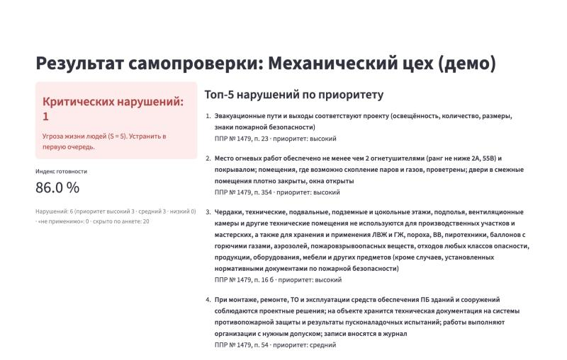

# FireCheck: fire-safety compliance self-check with risk-based prioritisation (prototype)

*Working name. Russian name of the project: «Цифровой сервис управления пожарной безопасностью производственного объекта».*

**Status (November 2026):** working research prototype on synthetic data. Not a production tool and not a substitute for a fire-safety inspection. The user interface, the regulatory base and the report are in Russian.

**Try it online: https://fantasm50.github.io/firecheck/** — the app runs entirely in your browser (Streamlit on Pyodide via [stlite](https://github.com/whitphx/stlite)), so answers never leave your device. The first load takes up to a minute; then press «Демо: типовой механический цех».



## The problem

A person responsible for fire safety at an industrial site has to check dozens of mandatory requirements spread across several legal acts, and then decide which violations to fix first. In 2026 Russia introduced a single official inspection checklist (EMERCOM Order No. 525 of 14.07.2026), while the main Fire Regime Rules (Government Decree No. 1479 of 16.09.2020) expire on 31.12.2026. Paper and spreadsheet checklists go out of date quickly and do not tell the user which violation is the most dangerous.

## What the prototype does

1. **Facility questionnaire** (floor count, people, fire-hazard category, fire-protection systems, processes) selects only the requirements that apply to this building.
2. **Checklist**: each item cites the exact clause of the Fire Regime Rules and is linked to a question of the official inspection checklist. The user answers *compliant / non-compliant / not applicable* (a comment is required for *not applicable*).
3. **Prioritisation** of non-conformities with an adapted FMEA scheme: severity S, occurrence O and detection D on 1–5 scales; a priority group from an S × O matrix with a life-safety override (S = 5 is always high); RPN = S × O × D is computed in parallel for research comparison.
4. **Result**: the number of *critical* violations (S = 5, threat to life) is shown above a readiness index, then the top five violations with clause references.
5. **Report** (Word/DOCX): critical violations, readiness index, 5 × 5 matrix, full register with "deadline" and "responsible person" fields, coverage of the official checklist, warnings.

Additional safeguards:
- the questionnaire asks whether the building is *required* to have fire alarm, warning and automatic extinguishing systems (Government Decree No. 1464), so a missing mandatory system is not hidden behind "not applicable";
- the app warns 30 days before and after the expiry date of each legal act the base relies on;
- a text-fingerprint check lists which clauses changed in a new edition of the Rules and which base items depend on them.

**Current scope:** one facility type (industrial building, fire-hazard class F5.1), 63 requirements in the demo set (73 in the base); 10 of the 27 questions of the official checklist are covered.

## Planned (not implemented)

Corrective-action tracking (action, owner, deadline, status, re-inspection with evidence), a calendar of mandatory periodic tasks, history of inspections. The order of these modules will be decided after interviews with practitioners.

## Research component

The prioritisation rule is the main methodological claim, and the current S, O, D scores are drafts. A pilot expert study is designed (protocol in Russian: [expert-study-protocol.md](docs/expert-study-protocol.md); status: draft, not yet approved by the supervisor):

> How closely do alternative rules for prioritising fire-safety nonconformities (RPN, a severity–occurrence matrix with a life-safety override, and three-level priority groups) agree with the holistic priority rankings of fire-safety experts, and how consistent are the experts with each other?

Design: experts first rank 20 concrete situations blind, then score S, O, D; rules are applied to the experts' median scores and compared with the consensus ranking (Kendall's W, Kendall's τ-b, Spearman's ρ, bootstrap intervals). The analysis code is in [study/](study/README.md) and was tested on synthetic answers before any data collection. **No expert data has been collected yet.**

## How to run

Online: open the link above, nothing to install. The page is `index.html` in this repository, published with GitHub Pages.

Locally (requires Python 3.12+):

```bash
python3 -m venv .venv
.venv/bin/pip install -r requirements-deploy.txt
.venv/bin/streamlit run app.py
```

Open http://localhost:8501 and press «Демо: типовой механический цех» (demo workshop) to see a full example.

Tests (`requirements.txt` includes pytest):

```bash
.venv/bin/pip install -r requirements.txt
.venv/bin/python -m pytest
```

## Repository structure

| Path | Content |
|---|---|
| `app.py` | Streamlit interface: questionnaire → checklist → result |
| `core/` | loading and validation of the YAML bases, checklist selection, scoring, DOCX report, validity dates, source fingerprints |
| `requirements_production.yaml` | requirements for an industrial building with clause references and applicability conditions |
| `scores_production_draft.yaml` | draft S, O, D scores and the priority matrix (**not expert data**) |
| `checklist_525.yaml` | questions of the official inspection checklist (Order No. 525) |
| `data/` | questionnaire, screen themes, text fingerprints of the Rules |
| `study/` | analysis of the planned expert study, synthetic dry run |
| `tests/` | reference tests from the specification (pytest) |

## Limitations

- Russian regulations only; transferability of the method to other jurisdictions is a hypothesis, not a result.
- S, O, D scores are drafts awaiting expert review; agreement with experts is not the same as correlation with real fire outcomes.
- The readiness index weights all requirements equally; critical violations are therefore shown separately and first.
- No user interviews or pilot yet; demand is a hypothesis.

## Authorship and use of AI

**Role of the author.** Project lead and domain lead: I defined the problem and the scope, made the product and methodological decisions and am responsible for the results. The code was written mostly by an AI coding assistant (Claude by Anthropic, through Claude Code) under my direction.

**Key decisions** (taken with advice from the accelerator mentor and the AI assistant):
- industrial buildings as the first facility type, based on the regional EMERCOM risk register (17 % of industrial buildings in the high-risk category);
- extending the concept from a one-off self-check to corrective-action management, after my own analysis of the functions of an existing commercial product (OT-Soft «Fire safety»);
- agreed to a life-safety override in the prioritisation rule (S = 5 always first) proposed by the AI assistant instead of plain RPN, because RPN ranks a locked emergency exit below damaged wiring;
- approved a two-stage blind design for the expert study, so that the study tests the rule rather than the draft scores.

**Own work:** choice of the topic from the list of university topics that can later be defended as a bachelor's thesis; selection and collection of the regulatory sources (Fire Regime Rules, the inspection checklist order, the decree on mandatory fire-protection systems and related acts) used for the AI-assisted analysis and for building the requirements base; analysis of a competing product and the extended concept; spot-checks of regulatory items against the primary texts; testing of the interface; presentations and defence of the project at the accelerator.

**What the AI assistant did:** most of the code and tests, drafts of the documentation and specifications, the draft S, O, D scores (marked in the data as `scored_by: draft_author`), fact-checking of the materials against the locally stored primary sources.

**Domain basis:** Russian fire-safety regulations (Fire Regime Rules, Government Decree No. 1479; inspection checklist, EMERCOM Order No. 525; and related acts), partly complemented by experience from an internship at the municipal civil defence and emergency management agency of Yuzhno-Sakhalinsk.

## Author

Kirill Pak, 4th-year student, Technosphere Safety (20.03.01), Sakhalin State University. Project No. 4 of the SakhalinTech Startup accelerator.

## License

© 2026 Kirill Pak. All rights reserved.

The code and documents are published for review only (for example, as part of an academic portfolio). No permission is granted to use, copy, modify or distribute them without the author's written consent.
